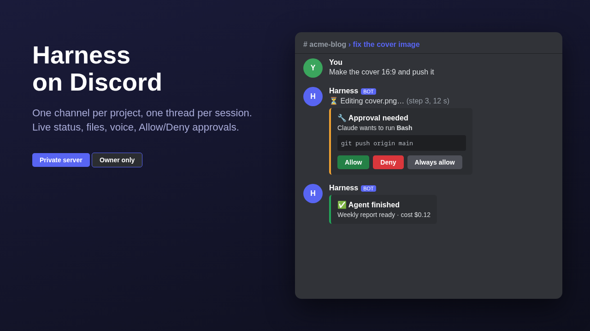

# Harness Discord

Talk to your [Harness Maxxing](https://harness-maxxing.com) sessions from your own Discord server: the same thing the
built-in Telegram gateway does, for Discord. One private category per purpose, one channel per Harness project, one
thread per session.

## What it does

- **Sessions**: write in a project channel, pick the topic (skipped when the project has only one), a thread is created
  and Claude answers in it. Write in the thread to go on. Messages sent while Claude works wait their turn.
- **Live status**: a message updated while Claude works (current step), folded into a summary (steps, time, cost)
  when the turn ends; the answer arrives as a new message. Long answers are split in several messages, tables become lists.
- **Files and voice**: attachments are saved in the topic (`attachments/`) and passed to Claude; Discord voice messages
  are transcribed by Harness.
- **Commands**: `/new [title]`, `/sessions`, `/stop`, `/close`, `/model [id]`, `/status`, `/help` (French or English,
  following the Harness language).
- **Alerts and notifications**: the Harness feed is posted in `alerts` (server problems, updates, sign-ins),
  `crons` (job reports), `agents` (requests with **Allow / Deny** buttons, failures) and `notifications` (everything else).
  An alert handled in Harness is updated in Discord too.
- **Agents**: each agent gets a thread in `agents` with its results; reply in the thread to start it again.
- **Bell**: when a turn started elsewhere (web UI) ends in a session with its bell on, a short "✅ title - preview" rings in its thread.
- **Settings page** in Harness (sidebar): status, owner, reply mode, what to relay, resync, test message, restart.

Not possible from outside the server: the two-step sign-in approval (it needs the product's internals).

## Requirements

- A Harness Maxxing server (the bridge talks to its HTTP API), `uv` (shipped with Harness), root access for the service.
- A Discord application with a bot, **Message Content Intent** on, invited with the scopes `bot` and
  `applications.commands` (Administrator, or Manage Channels / Send Messages / Create Public Threads / Manage Threads).
- In Harness **Settings -> Keys**: `DISCORD_BOT_TOKEN` and `HARNESS_PASSWORD`. The bridge signs in to Harness like you do,
  so keep two-step sign-in off. Neither key is ever stored in this repository or in the extension's files.

## Install

1. Copy the `discord/` folder to `<workspace>/extensions/discord/` (or let Harness install it from the community library).
2. As root: `sh <workspace>/extensions/discord/install.sh` (creates a virtualenv outside the folder and the `harness-discord`
   systemd service).
3. Open **Discord** in the Harness sidebar, enter your Discord user id (Discord: Settings -> Advanced -> Developer mode,
   right-click your name -> Copy user ID). The bot builds the categories and channels by itself.
4. Optional, the skill: `ln -s <this repo>/skill/discord-bridge <workspace>/.claude/skills/discord-bridge`.

Test: write in a project channel, or press **Send a test message** on the Discord page.

## What it sends, and where

- To **Discord**: your messages and files from the owner's channels, and Claude's answers, alerts and agent results.
- To **Harness**: your messages and files (its HTTP API, on the server itself).
- Nothing else leaves the server. Only the Discord user id you set can talk to the bot; mentions are never parsed.

## Remove

`systemctl disable --now harness-discord && rm /etc/systemd/system/harness-discord.service`, delete
`<workspace>/extensions/discord/` and the virtualenv `/var/lib/claude-maxxing/harness-discord-venv`, then delete the
Discord categories and the bot from the server and the two keys from Settings -> Keys.

## Develop

`discord/bridge/` is a small Python package (`httpx`, `websockets`); tests: `cd discord/bridge && pip install -e '.[dev]' && pytest`.

MIT licence.
